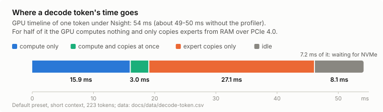
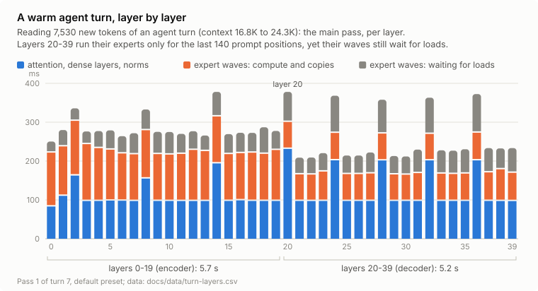
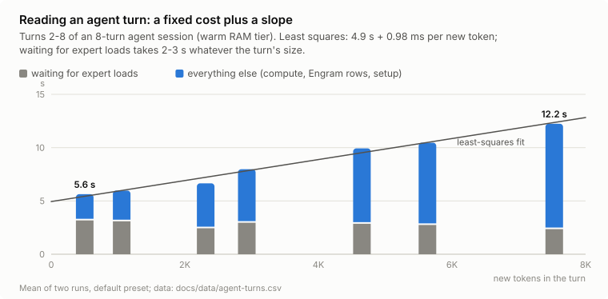

<p align="center"></p>

# Siege-Ladder

DeepSeek-V4.1-Flash-1017 on one 16 GB GPU and 64 GB of RAM, with the experts streamed from NVMe.

A personal project in the spirit of "what if?": what if a model several times larger than the memory of an ordinary PC
could still run on it at a usable speed — if the weights climb a ladder of memory levels instead of breaking through
the wall in one go.

> **Work in progress.** This is a research log with patches, not a finished engine: rough edges, some Windows-only
> parts, no support promises. Use any of it for anything you like — no credit needed (see [License](#license)).

## Goal

Long context, up to 1M tokens, at a usable speed on a single consumer PC — not necessarily at the full 1M.

## The box

| | |
|---|---|
| GPU | RTX 5070 Ti 16 GB in a PCIe 4.0 x16 slot (pinned host-to-device copies ~28.8 GB/s) |
| CPU / RAM | Ryzen 5 7600, 64 GB DDR5 (4 × 16 GB) |
| Drives | NVMe Gen5 2 TB (~13.5 GB/s) for the model; NVMe Gen4 1 TB (~5 GB/s) holding a second copy of the expert files |
| OS | Windows 11, CUDA 13.0 |

## The model build

DeepSeek-V4.1-Flash-1017 does not fit in RAM + VRAM. Our build is ~375 GB:

| part | type | source |
|---|---|---|
| routed experts, gate / up | IQ2_XS | prometheusAIR's 1017 GGUF |
| routed experts, down | Q2_K | prometheusAIR's 1017 GGUF |
| dense part (attention, shared experts, head) | Q5_K | ISTA-DASLab's 1017 GGUF |
| Engram tables (203 GB) | FP8, byte for byte | DeepSeek's official 1017 release |

The routed experts (~150 GiB at ~2.4 bits per weight) stream from NVMe; ~23 per layer sit in VRAM, a pinned RAM tier
holds 43–46 GiB of them. No weights are redistributed here — only a script that assembles the build from the public
repositories (TODO: see [Reproducing](#reproducing)).

## Numbers (today's defaults)

| | |
|---|---|
| decode, short context | 20.3 tok/s (17–20 in real agent turns at 2–27K context) |
| decode, fast preset | 23–24.7 tok/s (small measured quality cost) |
| decode at 256K / 512K context | 16–20 tok/s |
| reading agent turns (0.5–7.5K new tokens into a growing conversation, warm cache) | ~390 tok/s |
| cold prompt 8.9K / document 256K / document 512K | 672 / 633–652 / 482 tok/s |
| 1M context | loads at batch 512; a real 1M document not run yet |
| quality | 0.09–0.11 nat/token behind the DeepSeek API on its own continuations (3 prompt sets; for scale, Q2 to Q4 is ~0.11); HumanEval 157/164 vs 158 for the API |

On this PC with the same file (measured 2026-10-22): the original fork ~10 tok/s, Project Maya v1.1.21 3.9 tok/s.

**How it is measured.** Decode speed — teacher forcing over 3,072 tokens of real text (`llama-perplexity -ub 1`),
arms in A B B A order, corrected for random drive stalls. Quality — negative log-likelihood of the DeepSeek API's own
continuations on three prompt sets (general-100 from antirez's ds4 quality tests, a 112-prompt code and agent set, and
a Russian set; continuations collected from the API for 1017), shown as the distance to the full model (smaller is
better). Reading — the server's own prompt timings.

## What helped most

1. **A three-step ladder for the experts:** ~23 per layer cached in VRAM, a pinned RAM tier (43–46 GiB), unbuffered
   NVMe reads (an NTFS file that is also memory-mapped reads 3× slower unbuffered — we stopped mapping it), and a
   second NVMe with a copy of the expert files (a read goes to the copy with fewer reads in flight).
2. **The CPU off the critical path:** the GPU reads routing replies from pinned memory written by the host, one
   wake-up per token, graph reuse — host overhead went from ~7 ms to ~1 ms per token.
3. **Heavy experts ahead:** a cheap "lens" (layer L+2's router applied to layer L's input) predicts the heavy experts
   that would come from disk, and they are read into RAM 2 layers early (+3.5–4%).
4. **A measured lossy rule:** an expert in neither VRAM nor RAM with less than 14% of the routing weight is not waited
   for (costs at most 0.006 nat/token on our API sets).
5. **Prefill:**
   - experts go through the GPU in waves via a shared pool;
   - positions the decoder half never reads run through the encoder layers only (exact);
   - DeepSeek's YoCo truncation (DeepInfer's default for V4.1): the decoder half (layers 20–39) computes only the last
     140 prompt positions. We skip its experts for the other rows (attention and dense layers still run on all of
     them) — +13% on agent turns, +60% on a cold 8.9K prompt, within error on our API sets.
6. **Sparse attention in decode with a q8 KV cache:** decode stays at 16–20 tok/s from short context to 512K.
7. **A quant mix from public GGUFs:** prometheusAIR's IQ2_XS gate/up + Q2_K down, ISTA-DASLab's lighter Q5_K dense part
   (3 GB less VRAM, so more expert slots: +8.5% decode, and closer to the API than a plain 2-bit mix).

## What didn't work

- **Reading the next layer's experts ahead during prefill:** the RAM tier can't hold a prompt's working set, so
  read-ahead evicts what is still needed (≈0 even with a perfect oracle).
- **"Free" guesses in the bus's idle time:** during decode there is none; each wrong staging into VRAM costs ~0.2 ms.
- **A published non-uniform quant (GSQ-RCO) instead of our mix:** lower error offline, worse on our API sets
  (+0.02 nat, +0.034 on Russian prompts) — the calibration text matters.
- **Splitting expert reads into chunks, CUDA graph optimizations:** within noise.

## Where the time goes

Measured with Nsight Systems and the server's timings; the numbers behind each chart are in [docs/data](docs/data).

<picture>
  <source media="(prefers-color-scheme: dark)" srcset="docs/img/decode-token-dark.svg">
  
</picture>

<picture>
  <source media="(prefers-color-scheme: dark)" srcset="docs/img/turn-layers-dark.svg">
  
</picture>

<picture>
  <source media="(prefers-color-scheme: dark)" srcset="docs/img/agent-turns-dark.svg">
  
</picture>

## Where we're stuck — ideas welcome

1. **Predicting which experts a token needs 1–2 layers ahead.** Perfect staging into VRAM would give 27–29 tok/s; our
   lens reaches 76% precision at ~14% recall (it needs ≥65–70% precision at ≥50% recall to pay off).
2. **Overlapping compute with expert copies:** copies take ~30 ms per token, compute ~19 ms, and they overlap by 3 ms.
3. **Short agent turns:** reading a turn costs ~5.3 s plus ~1.04 ms per new token, so even a 500-token turn takes 6 s.
   Waiting for expert loads is 2–3 s of every turn whatever its size; a 7.5K-token turn also spends 1.3 s reading
   Engram rows before its first kernel, and every turn ~1 s on GPU memory setup and a 4-token tail call.
4. **1M context:** loads only at batch 512 — the sparse prefill plan wants 11.7–15 GiB at larger batches.

**The bus is the wall.** Copying experts from RAM to the GPU over PCIe 4.0 takes ~30 ms of a ~49 ms token, which caps
decode at ~32 tok/s on this box even with perfect overlap.

**The CPU computes no experts.** A probe on this 6-core CPU gave only +3–5% for computing part of the RAM-resident
experts on the CPU, so the CPU path was left out; it needs separate work. Project Maya's CPU expert kernels (MIT) could
be a starting point.

## Reproducing

Not turnkey yet: the engine builds from this repository today; the weight assembly script and the benchmark scripts
are still being cleaned up for publishing. Built and run on Windows 11 only.

**1. The engine** — JigSawPT's llama.cpp fork with our patches on top:

```sh
git clone https://github.com/JigSawPT/llama.cpp
cd llama.cpp
git checkout 8ce0968539b1a6795f3413c2783dfa5646b4688a
git am /path/to/Siege-Ladder/patches/*.patch
```

On Windows, clone into a short path or set `git config --global core.longpaths true`: some of llama.cpp's web UI files
have long names. Build with CUDA 13.0 (13.2 miscompiles `mul_mat_id` for the IQ types on Blackwell). On Windows, from a Visual Studio
2022 x64 developer prompt:

```sh
cmake -B build -G Ninja -DCMAKE_BUILD_TYPE=Release -DGGML_CUDA=ON -DCMAKE_CUDA_ARCHITECTURES=120 -DLLAMA_CURL=OFF
cmake --build build --target llama-server llama-cli llama-perplexity
```

**2. The weights** — TODO: the assembly script and the GGUF headers it uses as a template (sources: prometheusAIR's
and ISTA-DASLab's GGUFs of 1017, DeepSeek's official 1017 release).

**3. Running** — the server line of our agent-turn measurements (up to 32K context; the model is the first of 11 GGUF
parts):

```sh
llama-server -m DeepSeek-V4.1-Flash-MXFP4-engram-00001-of-00011.gguf -ngl 99 -t 6 --parallel 1 --reasoning off \
  --moe-stream-direct --moe-stream-cache 22s --moe-stream-l2 43 \
  -c 32768 -b 32768 -ub 8192 -ctk q8_0 -ctv q8_0
```

- `--moe-stream-cache 22s` — expert slots per layer in VRAM; `--moe-stream-l2 43` — the pinned RAM tier, GiB;
  `--moe-stream-direct` — unbuffered NVMe reads.
- `LLAMA_MOE_STREAM_PRESET=exact | default | fast` — `default` when unset. `exact` adds no approximation beyond the
  quantized weights: every routed expert is waited for, and the prompt runs through all layers. `fast` trades a small
  measured quality cost for speed; its numbers above were measured on a lighter build (`qd`: IQ2_XXS gate/up experts,
  7% fewer expert bytes, the same dense part).
- `LLAMA_MOE_STREAM_MIRROR=<folder>` — a copy of the expert parts (5–11) on a second NVMe (up to three folders,
  `;`-separated); each read goes to the drive with fewer reads in flight.
- The patches read 114 environment switches in all, each documented where it is read (mostly
  `src/llama-moe-stream.cpp` and `src/models/deepseek4.cpp`); the commit messages say what each change measured.

**4. The benchmark scripts** — TODO.

## Repository layout

| path | what |
|---|---|
| `patches/` | 91 patches over JigSawPT's `dsv41-porte` @ `8ce0968`, oldest first; `series.txt` names the base and the order |
| `docs/img/`, `docs/data/` | the charts (light and dark) and the numbers behind them |
| `tools/make_charts.py` | draws the charts from `docs/data/*.csv` (plain SVG, no dependencies) |

## License

Our own code and notes: [MIT-0](LICENSE) — use them however you like, no attribution needed.

The patches modify llama.cpp (MIT, © the ggml authors) through JigSawPT's fork: whoever redistributes the patched
files keeps llama.cpp's license notice, as its license requires. See [NOTICE.md](NOTICE.md).

## Built on

JigSawPT (the DeepSeek-V4.1 port of llama.cpp with SSD streaming of experts), llama.cpp / ggml, DeepSeek (the model and
DeepInfer's YoCo prefill), Strata, Project Maya, antirez's ds4 (DwarfStar), and the prometheusAIR and ISTA-DASLab
quants of 1017.
