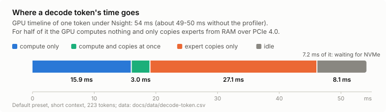
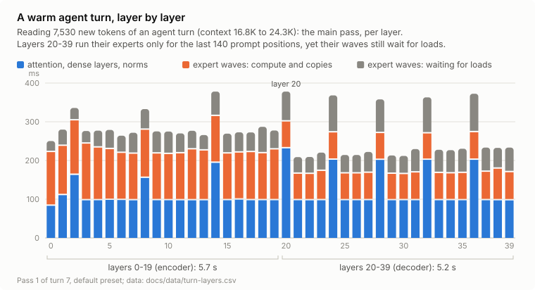
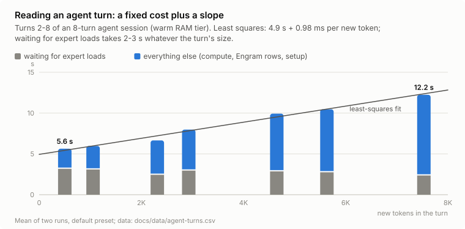
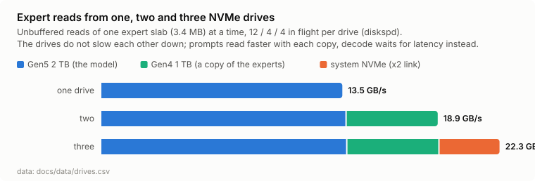

<p align="center"></p>

# Siege-Ladder

DeepSeek-V4.1-Flash-1017 on one 16 GB GPU and 64 GB of RAM, with the experts streamed from NVMe.

A personal project in the spirit of "what if?": what if a model several times larger than the memory of an ordinary PC
could still run on it at a usable speed — if the weights climb a ladder of memory levels instead of breaking through
the wall in one go.

> **Work in progress.** This is a research log with patches, not a finished engine: rough edges, some Windows-only
> parts, no support promises. Our own scripts and notes are yours to use for anything, no credit needed; the patched
> llama.cpp keeps its MIT notices (see [License](#license)).

## Goal

Long context, up to 1M tokens, at a usable speed on a single consumer PC — not necessarily at the full 1M.

## The box

| | |
|---|---|
| GPU | RTX 5070 Ti 16 GB in a PCIe 4.0 x16 slot (pinned host-to-device copies ~28.8 GB/s) |
| Display | the monitor is on the Ryzen's integrated graphics: the RTX 5070 Ti drives no display |
| CPU / RAM | Ryzen 5 7600, 64 GB DDR5 (4 × 16 GB) |
| Drives | NVMe Gen5 2 TB (~13.5 GB/s) for the model; NVMe Gen4 1 TB (~5 GB/s) holding a second copy of the expert files |
| OS | Windows 11, CUDA 13.0 |

**The GPU drives no display, and this is required.** With the monitor on the motherboard the RTX 5070 Ti runs
headless and the model gets all 16 GB. Do not plug the monitor into the card that holds the model: in our test a
2560×1440 240 Hz monitor on the same card made Windows page the card's memory, kernels ran 5–180× slower and decode
fell 3–4×, to 2–3 tok/s. The same hardware with the monitor on the GPU will not reproduce the numbers below.

**The numbers do not depend on the CPU.** It computes no experts or layers: everything runs on the GPU, and the CPU
only builds the graphs and issues the reads. The speed is set by the GPU, the PCIe link, RAM and the drives. Keep the
CPU otherwise idle during runs all the same.

## The model builds

DeepSeek-V4.1-Flash-1017 does not fit in RAM + VRAM. We use two builds with the same Q5_K dense part from
ISTA-DASLab and official FP8 Engram tables. Both stream the routed experts from NVMe.

| build | routed experts | availability |
|---|---|---|
| `og` (our current baseline) | our own GPTQ of all 40 layers on our calibration texts, with Maya-S's types: IQ2_XXS gate/up, IQ3_XXS down (IQ2_S / IQ3_S in layers 0–3 and 36–39) | [on Hugging Face](https://huggingface.co/MasherDon/DeepSeek-V4.1-Flash-1017-SiegeLadder-GGUF) (378 GB with the lens; not the final version) |
| `cd` (public assembly, 373 GB) | prometheusAIR's IQ2_XS gate/up and Q2_K down | assembled from public sources by the script below |

`og` is published as it runs here: the 11 GGUF parts and the lens file. It is not the final version: work on
quantization quality continues, and better builds will replace it. `cd` is assembled from public sources by the
script below; its own numbers are listed after `og`'s. The fast-preset measurements use the lighter `qd` build
(IQ2_XXS gate/up). See [Reproducing](#reproducing).

## Numbers (the defaults of 5 November 2026)

The current `default` includes the expert drop rule and YoCo; it is not the lossless `exact` preset. The current
expert prediction needs a 149 MB lens file (a learned correction of the router lens), published with the `og`
weights; without the file the engine falls back to the older prediction. From 256K context the prompt is read layer-major (on by default since
5 November; see [What helped most](#what-helped-most)). Dates below identify the measurements, not a claim that
every row was remeasured on the same day.

| `og`, unless stated | measurement |
|---|---|
| short-context decode, teacher-forced | 21.30 tok/s with the current expert prediction (4 November) |
| agent turns 2–8, server | 18.7 tok/s decode; 506–520 tok/s reading (28 October, before the current expert prediction) |
| `qd` fast / fast with 5 experts per token | 23.46 / 24.97 tok/s, respectively; additional quality trade-offs (28 October, before the lens correction) |
| `qd` fast with the lens correction | 23.7 tok/s (3 November; low free RAM during the series) |
| decode, short context, server | 18.44 / 18.80 tok/s (6 November, two runs of the Maya comparison below) |
| document in a 256K context | 246,135 tokens at 1128.0 tok/s (6 November, mean of two runs) |
| document in a 512K context | 478,928 tokens at 1042.99 tok/s (6 November, one run) |
| document in a 1M context | 947,417 tokens at 887.93 tok/s; answer 15.23 tok/s (6 November, one run) |
| quality, distance to API | approximately 0.091 / 0.054 / 0.072 nat/token on general-100 / general-2 / router-112; HumanEval 160/164 (27–28 October, before the current expert prediction) |

The publicly assembled `cd` with the defaults of 25–26 October (before the current expert prediction):

| `cd` | measurement |
|---|---|
| decode, short context | 20.3 tok/s (17–20 in real agent turns at 2–27K context) |
| decode at 256K / 512K context | 16–20 tok/s |
| reading agent turns (0.5–7.5K new tokens into a growing conversation, warm cache) | ~418 tok/s |
| cold prompt 2.2K / 8.9K | 242 / 729 tok/s |
| document 256K / 512K | 652 / 482 tok/s |
| document in a 1M context (945,619 tokens, 26 October) | 470.7 tok/s (33.5 minutes); answers 13.8–15.15 tok/s |
| quality | 0.09–0.11 nat/token behind the DeepSeek API on its own continuations; HumanEval 157/164 vs 158 for the API |

The `og` and `cd` rows are separate runs with different settings, not an isolated measurement of the quantization.

**Fast mode (lossy).** `LLAMA_MOE_STREAM_PRESET=fast` adds one approximation to `default`: per token, up to one
light expert that would come from the drive is not waited for; its contribution is added after the next layer's
attention. Five experts per token instead of six is a separate switch (`--override-kv deepseek41.expert_used_count=int:5`). Both were measured on
the lighter `qd` build (362 GB, IQ2_XXS gate/up experts; assembled by `tools/assemble.py --build qd`, not published on
Hugging Face). Decode is teacher-forced; the distance is to the DeepSeek API on general-100 / general-2 / router-112,
and smaller is closer to the full model:

| | decode, tok/s | distance, nat/token |
|---|---|---|
| `og` `default` | 21.30 (4 November) | ~0.091 / 0.054 / 0.072 (27–28 October) |
| `qd` `fast` | 23.7 (3 November) | 0.143 / 0.102 / 0.126 (25 October) |
| `qd` `fast` + 5 experts per token | 24.97 (28 October, before the lens correction) | another +0.010–0.013 (25 October) |

That is ~11% faster decode for ~0.05 nat more distance. Most of that distance comes from the lighter build: on `qd`
the preset itself costs 0.006–0.014. `fast` on `og` and `fast` through the server have not been measured yet.

On this PC with the `cd` file (measured 2026-10-22): the original fork ~10 tok/s, Project Maya v1.1.21 3.9 tok/s. Maya has
shipped many releases since; these two numbers are from that day.

Project Maya v1.1.54 on the same `og` file (6 November 2026; the same token ids, greedy decoding, A B B A against
our `default`; both engines read only the Gen5 drive):

| | Maya v1.1.54 | ours | ours / Maya |
|---|---|---|---|
| decode, short context, tok/s | 3.32 | 18.62 | ×5.6 |
| decode after a 30K document | 3.7 | 15.0 | ×4.1 |
| prompt 2K | 131.8 | 265.5 | ×2.0 |
| prompt 8K | 472.4 | 797.4 | ×1.69 |
| document 30K | 918.0 | 1050.4 | ×1.14 |

Maya's best of four configurations: streaming on, a 40 GB RAM copy of the experts, `MAYA_DS4_Q8MV_TC=1`. It keeps
284 of the 15,360 experts in VRAM and computes about half of the decode experts on the CPU; our engine computes all
experts on the GPU.

**How it is measured.** Short-context decode uses teacher forcing, with YoCo disabled during that test, in A B B A
order. Agent and document readings use server prompt timings. Quality is negative log-likelihood of the DeepSeek
API's own continuations on three prompt sets; smaller distance to the API is better. The quality checks of the current
expert prediction were within statistical uncertainty on these sets, but do not establish equivalence (4 November).
Details: [docs/measuring.md](docs/measuring.md).

## Hardware notes

- **PCIe 5.0.** With a PCIe 5.0 x16 card *and* slot, both prompt reading and decode should get faster with no code
  change: copying experts over the bus is the largest part of a decode token. In an older profile the copies alone
  took 27.1 ms of a 54 ms token; halving them gives about 24.7 instead of 18.5 tok/s (an estimate).
- **A second NVMe** with a copy of the expert files helps prompt reading somewhat (+14–22% on cold prompts in an
  older test) and decode very little. It is optional.
- **Hot files slow down on the SSD.** The Engram tables take billions of small reads. After a few weeks, their 4 KiB
  random reads on our Gen5 drive fell from ~400K to ~40K IOPS (other files on the same drive: ~235K), and the 512K
  document read at 685 instead of 1051 tok/s. Rewriting the two Engram files restored them; it looks like read
  disturb. If long documents slow down over time, check the drive before the code.
- **Training.** Speed will also improve separately, by training the expert prediction, independently of the weights.

## What helped most

1. **A three-step ladder for the experts:** ~23 per layer cached in VRAM, a pinned RAM tier (43–46 GiB), unbuffered
   NVMe reads (an NTFS file that is also memory-mapped reads 3× slower unbuffered — we stopped mapping it), and a
   second NVMe with a copy of the expert files (a read goes to the copy with fewer reads in flight).
2. **The CPU off the critical path:** the GPU reads routing replies from pinned memory written by the host, one
   wake-up per token, graph reuse — host overhead went from ~7 ms to ~1 ms per token.
3. **Heavy experts ahead:** a cheap "lens" (layer L+2's router applied to layer L's input) predicts the heavy experts
   that would come from disk, and they are read into RAM 2 layers early (+3.5–4%).
4. **A measured lossy rule:** an expert in neither VRAM nor RAM with less than 14% of the routing weight is not waited
   for (costs at most 0.006 nat/token on our API sets).
5. **Prefill:**
   - experts go through the GPU in waves via a shared pool;
   - positions the decoder half never reads run through the encoder layers only (exact);
   - DeepSeek's YoCo truncation (DeepInfer's default for V4.1): the decoder half (layers 20–39) computes only the last
     140 prompt positions. We skip its experts for the other rows (attention and dense layers still run on all of
     them) — +13% on agent turns, +60% on a cold 8.9K prompt, within error on our API sets;
   - a prompt's Engram rows are faulted in layer by layer under the compute of the layers before them, instead of all
     before the first kernel (bit-exact; +5.6% on agent turns, +9% / +6% on cold 2.2K / 8.9K prompts), and the pinned
     host blocks of the compute buffer are kept between prompts (+3.7% on agent turns).
6. **Sparse attention in decode with a q8 KV cache:** decode stays at 16–20 tok/s from short context to 512K.
7. **The public `cd` quant mix:** prometheusAIR's IQ2_XS gate/up + Q2_K down, ISTA-DASLab's lighter Q5_K dense part
   (3 GB less VRAM, so more expert slots: +8.5% decode, and at least as close to the API as a plain 2-bit mix).

8. **Updated expert prediction:** a learned correction of the lens gave +2.3% decode in `default` with GPU
   scheduling enabled (3 November; the two pairs differed). Staging one prediction into VRAM ahead of time added
   +5.1% on top (4 November); it changes cache occupancy and can change drops on the measured `default` path.
9. **Long prompts and Engram:** two batch widths made the 1M `cd` document 2.42× faster than batch 512; direct
   reads from unmapped Engram tables cut agent-turn reading time by 5.2%. Cutting decoder rows for YoCo cut it by
   14% in its comparison. These are separate configurations, measured 26 October.
   Keeping a host copy of the output head saved 35 ms per turn in a separate test.
10. **Layer-major prefill for long documents** (on by default from 256K context, 5 November): each layer runs over
    the whole prompt before the next one, so a layer's experts are read once for the document instead of once per
    batch. The 1M document on `og` went from 365.78 tok/s on the ordinary path (4 November) to 777.62 layer-major
    (5 November), and to 887.93 once the Engram files were rewritten (6 November; see [Hardware notes](#hardware-notes)).
    The output matched the ordinary path byte for byte in a 48K check. Below 256K it is still slower, so the
    ordinary path stays there.

## What didn't work

- **Reading the next layer's experts ahead during prefill:** the RAM tier can't hold a prompt's working set, so
  read-ahead evicts what is still needed (≈0 even with a perfect oracle).
- **"Free" guesses in the bus's idle time:** during decode there is none; each wrong staging into VRAM costs ~0.2 ms.
- **A published non-uniform quant (GSQ-RCO) instead of our mix:** lower error offline, worse on our API sets
  (+0.02 nat, up to +0.034 on one of the sets) — the calibration text matters.
- **Splitting expert reads into chunks, CUDA graph optimizations:** within noise.
- **Routes from repeated text:** only 0.3–6% of disk-waiting calls removed, with 1.3–3.5× disk reads in an offline
  trace (27 October).
- **Substituting another expert for a dropped one:** 1.26–1.37× the output error of dropping in an offline test
  (28 October).
- **Layer-major prefill below 256K:** at 128K it is still slower than the ordinary path (4–5 November), so it
  switches on only from 256K context.

## Where the time goes

Measured with Nsight Systems and the server's timings on the earlier configuration; the numbers behind each chart
are in [docs/data](docs/data).

<picture>
  <source media="(prefers-color-scheme: dark)" srcset="docs/img/decode-token-dark.svg">
  
</picture>

<picture>
  <source media="(prefers-color-scheme: dark)" srcset="docs/img/turn-layers-dark.svg">
  
</picture>

<picture>
  <source media="(prefers-color-scheme: dark)" srcset="docs/img/agent-turns-dark.svg">
  
</picture>

<picture>
  <source media="(prefers-color-scheme: dark)" srcset="docs/img/drives-dark.svg">
  
</picture>

More: [what each change does and measured](docs/techniques.md), [how we measure](docs/measuring.md), [the
environment switches](docs/switches.md).

## Where we're stuck — ideas welcome

1. **Predicting which experts a token needs 1–2 layers ahead.** Perfect prediction on `og` would give 27.89 tok/s
   against 20.30 for the 28 October default; the lens before its learned correction reached 76% precision at ~14% recall (it needs
   ≥65–70% precision at ≥50% recall to pay off).
2. **Overlapping compute with expert copies:** copies take ~30 ms per token, compute ~19 ms, and they overlap by 3 ms.
3. **Short agent turns:** reading a turn costs ~5 s plus ~1 ms per new token (26 October), and 2–3 s of every turn is
   waiting for expert loads.
4. **Long-document prefill:** layer-major prefill reads 256K–1M documents at 887.93–1128.0 tok/s (6 November), but
   below 256K it is still slower than the ordinary path: graph inputs, state transfers and GPU compute remain costly.
5. **Long-context quality:** the short quality sets do not establish quality at 1M, or prove equivalence after the
   latest prediction changes.

Ideas, questions and results on other hardware are welcome in the issues.

**The bus is the wall.** Copying experts from RAM to the GPU over PCIe 4.0 takes ~30 ms of a ~49 ms token, which caps
decode at ~32 tok/s on this box even with perfect overlap.

**The CPU computes no experts.** A probe on this 6-core CPU gave only +3–5% for computing part of the RAM-resident
experts on the CPU, so the CPU path was left out; it needs separate work. Project Maya's CPU expert kernels (MIT) could
be a starting point.

## Reproducing

Not turnkey: a research setup, built and run on Windows 11 only. What it needs:

- an NVIDIA GPU with 16 GB that drives no display: the monitor goes to the CPU's integrated graphics or a second card
  (the build line targets Blackwell, `sm_120`; set `CMAKE_CUDA_ARCHITECTURES` for others);
- 64 GB of RAM (the RAM tier takes 43–46 GiB, pinned);
- ~375 GB on a fast NVMe (Gen4 or Gen5) for the weights, and ~175 GB on a second drive for the optional copy of the
  expert parts;
- Windows 10/11 (parts of the patches deal with WDDM's memory budget), CUDA 13.0, Python 3.10+ for the scripts.

**1. The engine** — JigSawPT's llama.cpp fork with our patches on top:

```sh
git clone https://github.com/JigSawPT/llama.cpp
cd llama.cpp
git checkout 8ce0968539b1a6795f3413c2783dfa5646b4688a
git am /path/to/Siege-Ladder/patches/*.patch
```

On Windows, clone into a short path or set `git config --global core.longpaths true`: some of llama.cpp's web UI files
have long names. Build with CUDA 13.0 (13.2 miscompiles `mul_mat_id` for the IQ types on Blackwell). On Windows, from a Visual Studio
2022 x64 developer prompt:

```sh
cmake -B build -G Ninja -DCMAKE_BUILD_TYPE=Release -DGGML_CUDA=ON -DCMAKE_CUDA_ARCHITECTURES=120 -DLLAMA_CURL=OFF
cmake --build build --target llama-server llama-cli llama-perplexity llama-logits
```

**2. The weights.** `og`: download the 11 GGUF parts and `g44/1017-lens-d2.gguf` from [Hugging Face](https://huggingface.co/MasherDon/DeepSeek-V4.1-Flash-1017-SiegeLadder-GGUF).
The engine looks for the lens in a folder named `g44` next to the model's folder: move `g44` one level up after the
download, or point `LLAMA_MOE_STREAM_G44` at the file. `cd` and `qd`: `tools/assemble.py` copies every tensor byte
for byte from the public repositories at pinned
revisions (prometheusAIR's and ISTA-DASLab's GGUFs of 1017, DeepSeek's official 1017 release) into the 11 GGUF parts
of our build, by HTTP range requests, so only the bytes the build uses are downloaded (373 GB, no full source files).
Python 3 only, resumable; `template/` holds the parts' GGUF headers and a manifest with each tensor's source.

```sh
python tools/assemble.py D:/models/v41-cd --plan     # what will be fetched and written
python tools/assemble.py D:/models/v41-cd            # run it; run it again to resume after an interruption
python tools/assemble.py D:/models/v41-cd --check    # compare both ends of every tensor with its source
```

`--build qd` assembles the fast preset's lighter build (362 GB) instead. Source files you already have whole can be
used with `--sources <folder>` (and checked with `--verify-sources`).

**3. Running** — the server line of our agent-turn measurements (up to 32K context; the model is the first of 11 GGUF
parts):

```sh
llama-server -m DeepSeek-V4.1-Flash-MXFP4-engram-00001-of-00011.gguf -ngl 99 -t 6 --parallel 1 --reasoning off \
  --moe-stream-direct --moe-stream-cache 22s --moe-stream-l2 43 \
  -c 32768 -b 32768 -ub 8192 -ctk q8_0 -ctv q8_0
```

- `--moe-stream-cache 22s` — expert slots per layer in VRAM; `--moe-stream-l2 43` — the pinned RAM tier, GiB;
  `--moe-stream-direct` — unbuffered NVMe reads.
- `LLAMA_MOE_STREAM_PRESET=exact | default | fast` — `default` when unset. `exact` adds no approximation beyond the
  quantized weights: every routed expert is waited for, and the prompt runs through all layers. `fast` trades a small
  measured quality cost for speed; its numbers above were measured on a lighter build (`qd`: IQ2_XXS gate/up experts,
  7% fewer expert bytes, the same dense part).
- `LLAMA_MOE_STREAM_MIRROR=<folder>` — a copy of the expert parts (5–11) on a second NVMe (up to three folders,
  `;`-separated); each read goes to the drive with fewer reads in flight.
- The patches read 116 environment switches in all, each documented where it is read (mostly
  `src/llama-moe-stream.cpp` and `src/models/deepseek4.cpp`); the commit messages say what each change measured.

**4. The benchmark scripts** — `bench/`, Python 3, no packages; set the paths in `bench/config.json` (see
`bench/config.py`) and see [docs/measuring.md](docs/measuring.md):

```sh
python bench/harness.py run mytest --            # the server on a set of prompts: speeds and the fork's counters
python bench/agent_turns.py turns                # the 8-turn agent session behind "reading agent turns"
python bench/tf_run.py out/tf mytext.txt --arm base --arm fast PRESET=fast   # teacher-forced decode, A B B A
python bench/tf_series.py out/tf                 # its summary, corrected for drive stalls
```

## Repository layout

| path | what |
|---|---|
| `patches/` | 121 patches over JigSawPT's `dsv41-porte` @ `8ce0968`, oldest first; `series.txt` names the base and the order. The commit messages quote their measurements and cite sections of our own log (`runs.md 4.xx`), which is not published |
| `bench/` | the benchmark scripts: server runs, agent turns, long documents, teacher-forced decode, quality against the API, Nsight profiles |
| `docs/` | [techniques](docs/techniques.md), [measuring](docs/measuring.md), [switches](docs/switches.md) |
| `docs/img/`, `docs/data/` | the charts (light and dark) and the numbers behind them |
| `tools/assemble.py`, `template/` | assembles the weights; the GGUF headers and source manifests of the `cd` and `qd` builds |
| `tools/make_charts.py` | draws the charts from `docs/data/*.csv` (plain SVG, no dependencies) |

## License

Our own code and notes: [MIT-0](LICENSE) — use them however you like, no attribution needed.

The patches modify llama.cpp (MIT, © the ggml authors) through JigSawPT's fork, including its expert streaming path
from Crow (MIT, © nibor1896): whoever redistributes the patched files keeps both notices
([patches/LICENSE-llama.cpp](patches/LICENSE-llama.cpp), [patches/LICENSE-Crow](patches/LICENSE-Crow)), as those
licenses require. See [NOTICE.md](NOTICE.md).

## Built on

- [JigSawPT's llama.cpp fork](https://github.com/JigSawPT/llama.cpp) (`dsv41-porte`): the DeepSeek-V4.1 port with SSD
  streaming of experts that the patches build on; their own report, on an RTX 5090 with 126 GB of RAM, is
  [deepseek-v41-flash-on-5090](https://github.com/JigSawPT/deepseek-v41-flash-on-5090);
- [Crow](https://github.com/nibor1896/Crow) by nibor1896: the expert streaming path of that fork;
- [llama.cpp / ggml](https://github.com/ggml-org/llama.cpp);
- DeepSeek: [the model](https://huggingface.co/deepseek-ai/DeepSeek-V4.1-Flash-1017) and
  [DeepInfer](https://github.com/deepseek-ai/DeepInfer) (the YoCo prefill);
- [antirez's ds4](https://github.com/antirez/ds4): the quality tests and the scoring method;
- [Strata](https://github.com/Niko1221/Strata) and [Project Maya](https://github.com/mw00/project-maya): ideas we
  compared against and borrowed (no code);
- the quants of 1017 by [prometheusAIR](https://huggingface.co/prometheusAIR/DeepSeek-V4.1-Flash-1017-GGUF) and
  [ISTA-DASLab](https://huggingface.co/ISTA-DASLab/DeepSeek-V4.1-Flash-1017-GSQ-RCO-GGUF).
